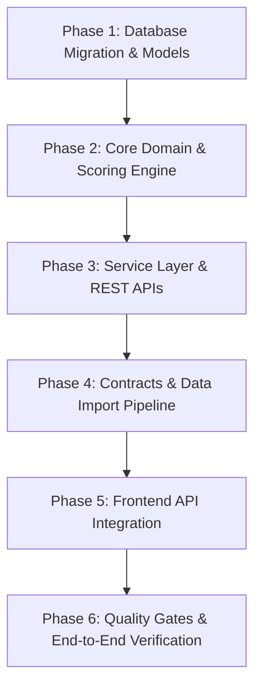

# Kế Hoạch Triển Khai Module IELTS (Exam / IELTS Module Plan)

Tài liệu này mô tả chi tiết lộ trình triển khai toàn diện module luyện thi IELTS trên nền tảng **Engflex Ultimate**, kết nối từ Database (PostgreSQL), Backend (Go + Gin + GORM), Shared Contracts (TypeScript) đến Frontend (TanStack Start/Router).

---

## 1. Kiến Trúc Tổng Thể & Nguyên Tắc Thiết Kế

- **Kiến trúc:** Mở rộng mô hình Unified Exam (`exam_categories`, `exam_tests`, `attempts`), đa hình (polymorphic) theo `type = 'ielts'`.
- **Tuân thủ `AGENTS.md`:**
  - Không tạo bảng thừa, không in-memory join trong service/controller.
  - Closed set phải là Go enum + PostgreSQL `CHECK` constraint.
  - Mapping dữ liệu tự động 100% qua `utils.Map`/`MapSlice`.
  - Logging đầy đủ 2 chiều (Success `slog.InfoContext` & Failure `logger.Report`).
  - Strict UI Quality Gates (i18n Paraglide, typed routes, zero hardcoded URLs).

---

## 2. Lộ Trình Triển Khai Từng Phase

---

### Phase 1: Database Migration & Models Foundation
**Mục tiêu:** Mở khóa hỗ trợ IELTS trong database PostgreSQL và cập nhật GORM models.

1. **Goose SQL Migration (`apps/api/internal/database/migrations/`):**
   - Tạo file migration mới: `YYYYMMDDHHMMSS_support_ielts_exam.sql`.
   - **`exam_categories`**:
     - Drop constraint `chk_exam_categories_type`.
     - Thêm constraint mới: `CHECK (type IN ('toeic', 'ielts'))`.
   - **`attempts`**:
     - Cập nhật constraint `chk_attempts_selected_parts`: Xóa bỏ điều kiện ép buộc TOEIC `mode = 'exam' -> cardinality = 7`, cho phép số lượng part linh hoạt theo format IELTS (3 sections Reading, 4 sections Listening).
   - **`exam_tests`**:
     - Thêm 2 cột metadata hỗ trợ lọc và index:
       - `skill text CONSTRAINT chk_exam_tests_skill CHECK (skill IS NULL OR skill IN ('reading', 'listening', 'writing', 'speaking', 'full'))`
       - `sub_type text CONSTRAINT chk_exam_tests_sub_type CHECK (sub_type IS NULL OR sub_type IN ('academic', 'general_training'))`
     - Tạo index: `CREATE INDEX idx_exam_tests_skill_sub_type ON exam_tests (skill, sub_type);`

2. **Go Enums & Models (`apps/api/internal/common/enums/` & `models/`):**
   - `enums/exam_type.go`: Thêm `ExamTypeIELTS ExamType = "ielts"`.
   - `enums/exam_skill.go`: Thêm các skill enum (`ExamSkillReading`, `ExamSkillListening`, v.v.).
   - `enums/exam_sub_type.go`: Thêm `ExamSubTypeAcademic`, `ExamSubTypeGeneralTraining`.
   - `models/exam.go` & `models/exam_category.go`: Cập nhật struct fields tương ứng.

---

### Phase 2: Core Domain Logic & Scoring Engine
**Mục tiêu:** Xây dựng package nghiệp vụ độc lập `internal/exams/ielts/` xử lý parse đề thi và tính điểm Band Score.

1. **`internal/exams/ielts/policy.go`:**
   - Hằng số thời gian thi:
     - Reading: 60 phút.
     - Listening: 40 phút (30 phút nghe + 10 phút transfer).
     - Writing: 60 phút.
   - Thang quy đổi Raw Score (0–40 câu đúng) sang **IELTS Band Score (0.0 – 9.0)**:
     - Bảng quy đổi riêng biệt cho **General Training Reading** (ví dụ: 30–31 câu = 6.5, 32–33 = 7.0, 34–35 = 7.5, 36 = 8.0).
     - Bảng quy đổi riêng cho **Academic Reading**.
     - Bảng quy đổi cho **Listening**.

2. **`internal/exams/ielts/content.go`:**
   - Struct định nghĩa nội dung đề thi IELTS lưu trong JSONB:
     - `Content`: `SchemaVersion`, `Title`, `Skill`, `SubType`, `Sections []Section`.
     - `Section`: `SectionNumber` (1, 2, 3), `Title`, `Passages []Passage`, `QuestionGroups []QuestionGroup`.
     - `Passage`: Các đoạn văn có gán nhãn A, B, C, D...
     - `Question`: Hỗ trợ đầy đủ các dạng bài IELTS:
       - Multiple Choice (1 đáp án hoặc nhiều đáp án).
       - True / False / Not Given & Yes / No / Not Given.
       - Matching Headings / Matching Features.
       - Gap-fill / Sentence Completion / Flowchart Completion / Table Completion.

3. **`internal/exams/ielts/result.go`:**
   - Struct lưu trữ và chấm câu trả lời của thí sinh:
     - `Answer`: Hỗ trợ `SelectedKey` (trắc nghiệm, T/F/NG), `SelectedKeys []string` (chọn nhiều đáp án), `TextValue` (dạng điền từ, tự động chuẩn hóa khoảng trắng và lowercase khi so khớp).
     - `Result`: `RawCorrect`, `RawTotal`, `BandScore`, `SectionScores`, `Answers []Answer`.

4. **Unit Tests:**
   - `policy_test.go`: Test toàn bộ các ngưỡng quy đổi điểm Band Score.
   - `content_test.go`: Test parse JSON schema đề thi mẫu.
   - `grading_test.go`: Test chấm điểm tự động đối với các dạng trắc nghiệm, T/F/NG, và điền từ (case-insensitive, trim space).

---

### Phase 3: Service Layer & REST APIs
**Mục tiêu:** Tích hợp logic IELTS vào REST API, phục vụ các luồng làm bài và tra cứu kết quả.

1. **Tối ưu `AttemptService` (`apps/api/internal/modules/exams/services/attempt_service.go`):**
   - Đa hình hóa theo `Category.Type`:
     - Nếu `type == enums.ExamTypeTOEIC` -> kích hoạt bộ engine `toeic`.
     - Nếu `type == enums.ExamTypeIELTS` -> kích hoạt bộ engine `ielts`.
   - Validate `SelectedParts`:
     - Với IELTS Reading: Các section hợp lệ là `[1, 2, 3]`; full exam yêu cầu đủ cả 3 section.
     - Tính `DeadlineAt` theo thời gian thi chuẩn (60 phút).
   - Nộp bài (`SubmitAttempt`):
     - Chấm điểm bài làm IELTS, tính Band Score (ví dụ: `7.5`), cập nhật `score` và `result` JSONB.

2. **Catalog & Test Controller (`apps/api/internal/modules/exams/controllers/exam_controller.go`):**
   - Hỗ trợ query params: `GET /api/v1/exams/categories?type=ielts`.
   - Hỗ trợ lọc danh sách đề thi theo `skill` (reading, listening) và `sub_type` (academic, general_training).
   - Chi tiết đề thi: `GET /api/v1/exams/tests/:id`.

3. **API Logging:**
   - Tuân thủ quy định `AGENTS.md`: Mọi hàm service đều log đầy đủ cả đường thành công (`slog.InfoContext`) lẫn đường lỗi (`logger.Report`).

---

### Phase 4: Shared Contracts & Data Import Pipeline
**Mục tiêu:** Đồng bộ types sang Frontend và script nhập đề thi vào hệ thống.

1. **Contracts (`packages/contracts/`):**
   - Định nghĩa DTOs request/response cho IELTS.
   - Chạy `tygo generate` sinh code TypeScript sang `packages/contracts/src/exams-responses.ts`.
   - Export types dùng chung cho frontend.

2. **Script Import Đề Thi (`apps/api/scripts/`):**
   - Xây dựng Python/Go script đọc file dữ liệu IELTS (từ STUDY4 crawled format hoặc file HTML đề thi).
   - Parse cấu trúc bài đọc, 40 câu hỏi, đáp án và lời giải chi tiết.
   - Lưu trữ media (audio listening, hình ảnh flowchart) vào storage/static hosting.
   - Insert vào database với slug chuẩn SEO.

---

### Phase 5: Frontend Integration & Live Data
**Mục tiêu:** Chuyển đổi giao diện IELTS frontend từ mock data sang kết nối API thực tế.

1. **Tổ chức Router (`apps/web/src/routes/_app/exams/`):**
   - `/exams/ielts`: Trang danh mục bài thi IELTS (Hub catalog, bộ lọc Academic / General Training, kỹ năng Reading / Listening).
   - `/exams/ielts/$categoryId`: Danh sách các đề trong bộ sách (ví dụ: Cambridge IELTS 18, GT Collection 1).
   - `/exams/ielts/$categoryId/$testId`: Trang preview bài thi (chọn làm Full Test 60 phút hoặc luyện từng Section).
   - `/exams/ielts/session/$id`: Phòng thi trực tuyến (giao diện 2 cột Passage & Question đã xây dựng, kết nối realtime API).
   - `/exams/ielts/session/$id/result`: Trang kết quả (Band Score, thống kê đúng/sai từng section, review giải thích chi tiết).

2. **TanStack Query & Service:**
   - Viết API client trong `apps/web/src/features/exams/ielts/service.ts`.
   - Caching & Mutations: `useStartIeltsAttempt`, `useSubmitIeltsAttempt`, `useIeltsDetail`.
   - Lưu trữ bản nháp (auto-save draft): Kết hợp LocalStorage và sync periodic API để học viên không bị mất đáp án khi reload hoặc rớt mạng.

3. **Đa ngôn ngữ i18n (`messages/{vi,en}/exams.json`):**
   - Đảm bảo 100% nhãn giao diện, nút bấm, hướng dẫn làm bài đều được khai báo song ngữ.

---

### Phase 6: Testing, Quality Gates & Production Readiness
**Mục tiêu:** Đảm bảo hệ thống đạt độ tin cậy tuyệt đối trước khi release.

1. **Backend Integration Tests:**
   - Viết test suite `ielts_lifecycle_integration_test.go`:
     - Tạo category IELTS + test IELTS.
     - Tạo attempt -> bắt đầu tính giờ deadline -> submit bài làm -> kiểm tra kết quả lưu vào database và điểm Band score.

2. **Frontend Quality Gates (Bắt buộc chạy và pass 100%):**
   - `pnpm --filter web check:conventions` (0 orphan keys, 0 hardcoded URLs).
   - `pnpm --filter web typecheck` (`tsc --noEmit` exit 0).
   - `pnpm --filter web check` (Biome lint/format).
   - `pnpm --filter web build` (Vite client & SSR build pass).

---

## 3. Bảng Theo Dõi Tiến Độ (Progress Checklist)

| Phase | Nhiệm Vụ Trọng Tâm | Trạng Thái | Người Phụ Trách |
| :--- | :--- | :---: | :---: |
| **Phase 0** | Mock UI `/exams/ielts` & tích hợp Sidebar | **Hoàn thành** (Branch `feat/exam/ielts`) | Pair Programming |
| **Phase 1** | Goose Migration (bỏ hardcode TOEIC, thêm cột skill/sub_type) | Sẵn sàng | Backend |
| **Phase 2** | Package Go `internal/exams/ielts/` & Scoring Engine | Chờ Phase 1 | Backend |
| **Phase 3** | Refactor `AttemptService` & Exam Controllers | Chờ Phase 2 | Backend |
| **Phase 4** | Sinh Contracts TypeScript & Viết Script Import Đề Thi | Chờ Phase 3 | Fullstack |
| **Phase 5** | Nối API vào giao diện `/exams/ielts` & Lưu đáp án | Chờ Phase 4 | Frontend |
| **Phase 6** | Chạy Integration Tests & Quality Gates | Chờ Phase 5 | QA / Lead |
