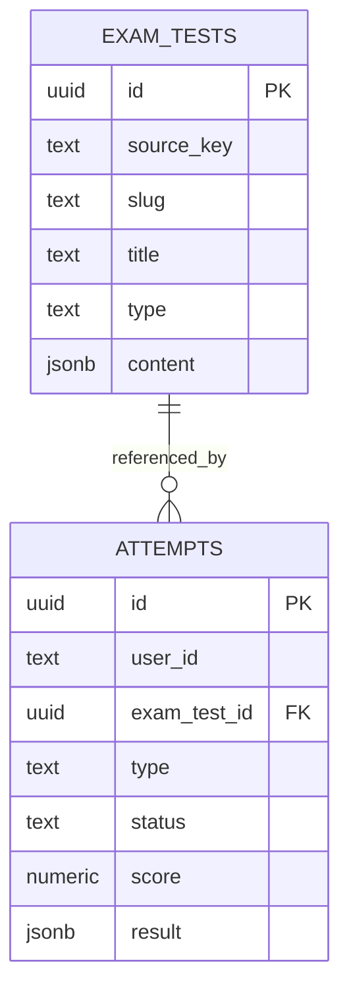

# TOEIC — Thiết kế dữ liệu đề thi và lượt làm bài

## 1. Trạng thái và các quyết định đã chốt

Tài liệu này là đặc tả thiết kế cho bước tích hợp Go/PostgreSQL, cập nhật ngày 2026-10-30. Chưa tạo migration, sửa model, import đề hoặc thay đổi DB trong phạm vi tài liệu này.

**Chỉ thêm một bảng `exam_tests`, mở rộng bảng `attempts` hiện có.** Không tạo bảng version, part, item, passage, question, option, exam_attempt hoặc answer riêng.

- Một row `exam_tests` là một đề có sẵn để người dùng làm; không quản lý phiên bản hoặc trạng thái xuất bản trong DB.
- `exam_tests.content` giữ nguyên cây `parts → items → passages/questions` bằng JSONB typed.
- Một row `attempts` là một lần làm bài của một user, tham chiếu đề qua exam_test_id.
- `attempts.score` là điểm tổng của lần làm bài; `attempts.result` chứa answers và kết quả từng part/section.
- Audio/ảnh ở object storage, content giữ media key cần dùng. Bằng chứng chỉ phục vụ pipeline, không có cột dẫn bằng chứng trong DB ứng dụng.
- Dữ liệu import là content đã lọc bằng allowlist, không phải toàn bộ draft của pipeline.

Các chi tiết vận hành đề xuất bên dưới cần được kiểm tra bằng code và PostgreSQL thật khi triển khai. Những thông số chưa chốt như thời gian từng section hoặc bảng quy đổi điểm không được tự điền bằng giả định.

## 2. Hiện trạng trong repo

| Thành phần | Hiện có |
| --- | --- |
| `apps/api/internal/database/models/attempt.go` | UserID, LessonID, VideoExerciseID, Type, Status, Score, Result, DurationSec, timestamps |
| `20261005193723_create_attempts.sql` | Bảng attempts, user_id là Clerk text; score numeric(5,2), result jsonb |
| `20261016091820_add_video_exercise_id_to_attempts.sql` | Quan hệ video exercise hiện có |
| `internal/common/enums/attempt_type.go` | Chưa có loại exam |
| `internal/common/enums/attempt_status.go` | Go có in_progress/completed; SQL còn cho phép abandoned |
| `internal/database/repositories/attempt_repository.go` | Có lịch sử, trạng thái và aggregate; CountCompleted hiện đếm mọi loại attempt |

Không có bảng users nội bộ để thêm FK user_id: tiếp tục dùng Clerk subject dạng text như các module hiện tại. Không thay lesson/video flow bằng exam flow.

## 3. Quan hệ tổng thể



`source_key` là danh tính nguồn ổn định và duy nhất, ví dụ `toeic_2024_test_02`; `id` là UUID của đề trong DB. Attempt trỏ UUID, không tìm lại đề qua slug. Không có nhiều row cho các phiên bản của cùng source_key.

Các ID câu hỏi/item/blank trong JSONB là source IDs, không phải FK PostgreSQL. Cặp exam_test_id + question ID xác định câu hỏi; service phải kiểm tra câu đó thuộc đề và selected_parts của attempt.

## 4. Bảng mới `exam_tests`

| Cột | PostgreSQL dự kiến | Null | Ý nghĩa |
| --- | --- | --- | --- |
| id | uuid PK | không | Default gen_random_uuid() |
| source_key | text | không | Ví dụ toeic_2024_test_02 |
| slug | text | không | Slug duy nhất của đề |
| title | text | không | Tên hiển thị |
| type | text + CHECK | không | Go enum ExamType; trước mắt toeic |
| content | jsonb | không | Nội dung phía server, có đáp án và lời giải |
| created_at | timestamptz | không | Thời điểm tạo |
| updated_at | timestamptz | không | Thời điểm cập nhật |

### 4.1. Constraints và indexes

- UNIQUE (source_key) và UNIQUE (slug) để chống import trùng nguồn và tránh đụng URL.
- CHECK cho type; JSONB root phải là object. Kiểm tra schema nội dung sâu ở importer/service bằng kiểu typed.
- Index phục vụ danh sách đề theo type khi query thực tế cần; không có index status hoặc version.
- Không tạo GIN index cho toàn bộ content theo mặc định; hiện chưa có nhu cầu tìm kiếm tùy ý sâu trong JSONB.

Chỉ import đề đã sẵn sàng sử dụng. Không lưu draft/published/archived trong exam_tests và không có bước publication switch ở DB. Trạng thái của attempts vẫn được giữ để quản lý lượt làm bài.

### 4.2. Sửa đề và bảo toàn lịch sử làm bài

Trước khi có attempt, người quản trị có thể sửa content sau khi kiểm tra hợp lệ. Khi đã có attempt, không ghi đè nội dung dùng để làm/chấm bài: stem, options, đáp án, passages, transcript, audio/ảnh hoặc ID liên kết. Có thể sửa tên hiển thị nhưng importer phải đồng bộ title giữa metadata và content nếu cả hai cùng chứa trường này.

Đường sửa đề và start attempt phải khóa cùng row exam_tests trong transaction trước khi kiểm tra/cập nhật, tránh race giữa “chưa có attempt” và tạo lượt làm đầu tiên. Không dùng upsert âm thầm ghi đè content. Media key đã được đề có lịch sử tham chiếu cũng không được ghi đè bằng file khác.

Không có version, status, content_hash hoặc evidence_key trong bảng exam_tests. Nếu cần sửa lỗi nội dung sau khi đã có người làm, phải xử lý riêng và đánh giá ảnh hưởng tới kết quả cũ; thiết kế này không tự hỗ trợ lịch sử sửa đề hoặc chấm lại. Đây là giới hạn được chấp nhận để giữ schema đơn giản, không tự thêm phiên bản ngầm.

## 5. Nội dung JSONB của đề

Schema import hiện có nằm tại `../content_export.py`; schema trích xuất giàu evidence nằm tại `../schemas.py`. Import DTO phía Go sẽ được thiết kế typed sau, không coi Go contracts hiện tại đã hỗ trợ TOEIC.

```text
content
  schemaVersion
  collectionId / testId / testNumber
  title
  audioAssetId
  assets[]                         # chỉ media thực sự dùng, key + checksum
  parts[]
    partNumber / section
    items[]
      id / type
      passages[]                   # Part 6/7; documents, không phải pages
        id / format / blocks[]
          paragraph/table/email/chat/image + inline nodes
      transcript[]                 # nội dung nghe dùng chung của item
      itemAudio / stimulusAudio
      media[]
      questions[]
        id / questionNumber
        stem / options[] / correctKey
        explanation / vietnameseText / vocabulary
        targetIds[]                # blank / insertion / marked-span references
```

- Part 1/2/5 là single item; Part 3/4/6/7 là group item theo nguồn.
- Part 3/4: một transcript và một audio range dùng chung cho nhóm ba câu.
- Part 6/7: một passage chỉ lưu trong group, không lặp trong từng câu hỏi.
- Single item vẫn giữ cùng cấu trúc questions[] hiện có để importer không tự flatten hoặc sửa schema đã export.
- Part 1/2 options.text có thể null; nội dung được đọc nằm trong transcript, không điền vào stem giả.
- Giữ bảng, paragraph breaks, blanks, vị trí chèn câu, marked spans và target IDs. Không gộp thành prose để giảm số byte.
- Null/mảng rỗng theo schema có nghĩa riêng; không xóa hàng loạt hoặc biến missing thành chuỗi rỗng.
- Metadata danh tính/title trong import phải khớp cột DB. Cột là nguồn cho listing, content là document của đề; importer chịu trách nhiệm đồng bộ, không có đường sửa riêng gây divergence.

Không nhúng PDF, ảnh base64, MP3, sourceRefs, answerRefs, tọa độ/font/confidence OCR hoặc raw LLM response vào content. Những dữ liệu đó có thể giữ ở artifacts của pipeline để kiểm tra quá trình trích xuất; DB và luồng làm bài không lưu hoặc cần liên kết tới chúng.

Các closed set cấp row như exam type và attempt mode/status phải là cột + Go enum + CHECK. Không có publication status cho đề. Các discriminator cấu trúc của typed document phải được parser/schema kiểm tra; nếu sau này trở thành thuộc tính cần lọc/index ở cấp row thì nâng thành cột, không giấu thuộc tính tra cứu trong blob.

schemaVersion trong JSON là phiên bản định dạng dữ liệu để parser đọc đúng hợp đồng, không phải phiên bản đề và không kéo theo cột version ở DB. scoringVersion trong result nếu dùng là định danh quy tắc quy đổi điểm, cũng không phải phiên bản đề.

## 6. Mở rộng `attempts`

### 6.1. Các cột giữ lại

| Cột hiện có | Cách dùng cho exam |
| --- | --- |
| id | UUID của một lần làm bài |
| user_id | Clerk subject của người làm |
| type | Thêm giá trị exam |
| status | in_progress/completed/abandoned sau khi đồng bộ enum và DB |
| score | Điểm tổng quy đổi của lần thi; chưa có điểm thì NULL |
| result | Answers, part/section results và summary typed theo type=exam |
| duration_sec | Thời lượng lần làm theo chính sách server |
| created_at/updated_at | Lịch sử tạo/cập nhật |
| lesson_id/video_exercise_id | NULL đối với exam |

Không thêm bảng exam_attempts. Không thêm user_id, status hoặc score lặp vào JSONB result.

### 6.2. Các cột mới

| Cột | PostgreSQL dự kiến | Ý nghĩa |
| --- | --- | --- |
| exam_test_id | uuid nullable FK | Đề mà user chọn làm |
| mode | text nullable + CHECK | Go enum ExamMode: exam/practice |
| selected_parts | smallint[] nullable | Các part được chọn, thứ tự canonical tăng dần |
| started_at | timestamptz nullable | Mốc server bắt đầu lượt làm |
| submitted_at | timestamptz nullable | Mốc server hoàn tất nộp/chấm |
| deadline_at | timestamptz nullable | Deadline theo policy; NULL khi practice không giới hạn |

Các cột mới nullable để không phá record lesson/video hiện tại. `started_at`, `submitted_at`, `deadline_at` có thể là timestamps dùng chung cho các loại attempt khi các module đó được nâng cấp; không tự backfill bằng giá trị đoán.

### 6.3. Constraints và indexes

- FK exam_test_id → exam_tests.id dùng ON DELETE RESTRICT/NO ACTION, không cascade xóa lịch sử khi xóa đề.
- Với type=exam: exam_test_id, mode, selected_parts và started_at bắt buộc; lesson_id/video_exercise_id phải NULL.
- Với type khác exam: exam_test_id/mode/selected_parts phải NULL. Không áp dụng ràng buộc “mọi attempt bắt buộc có một content FK” vì các flow hiện có có thể không có lesson/video.
- selected_parts không rỗng, chỉ thuộc 1–7; DB kiểm tra subset/cardinality phù hợp, service kiểm tra không trùng và normalize thứ tự. Exam mode bắt buộc đủ 7 part; practice cho phép tập con hợp lệ.
- Với exam completed: submitted_at bắt buộc; submitted_at >= started_at. Deadline nếu có không được trước started_at; duration_sec không âm.
- Không cấm submitted_at sau deadline: timeout finalizer có thể chạy muộn; thời điểm deadline vẫn là giới hạn nhận câu trả lời.
- score nullable, điểm hợp lệ được kiểm tra theo attempt type và scoring policy. Không áp một thang điểm chung cho lesson/video/exam.
- Giữ indexes user_created/user_type hiện có. Thêm index exam_test_id cho truy vấn/lịch sử theo đề và FK; thêm composite user/exam/status nếu resume query cần và EXPLAIN cho thấy hữu ích.
- Không đặt UNIQUE(user_id, exam_test_id): một user được làm lại nhiều lần. Bắt đầu request mới tạo attempt mới; chống retry tạo trùng dùng start idempotency policy, không cấm retake.

Với yêu cầu một row chứa tất cả answers, autosave sẽ khóa/cập nhật cùng một row. Đây là đánh đổi có chủ đích để giảm bảng; cần batching và kiểm soát concurrency, không ghi JSONB lớn sau mỗi thao tác UI nhỏ.

## 7. Điểm thuộc user thông qua attempt

| attempt | user | exam_test | score |
| --- | --- | --- | ---: |
| attempt-A1 | user-A | test-02 | 750 |
| attempt-B1 | user-B | test-02 | 820 |
| attempt-A2 | user-A | test-02 | 790 |

Đây là số minh họa cho quan hệ, không phải điểm được pipeline tính từ Test 02.

- `exam_tests` không lưu điểm user.
- `attempts.score` là nguồn duy nhất cho điểm tổng quy đổi; không lặp totalScore trong result.
- result.parts giữ số đúng/số câu/tỷ lệ đúng từng part. Nếu mỗi câu một điểm, correctCount đã là điểm thô; không thêm rawScore trùng giá trị.
- result.sections giữ kết quả Listening/Reading và điểm quy đổi nếu policy hỗ trợ.
- Practice tập con không được quy thành điểm toàn bài; attempts.score để NULL. Có thể giữ section score chỉ khi làm đủ section và có policy quy đổi được xác nhận.
- Chưa có bảng quy đổi đáng tin cậy thì score/scaledScore để NULL, kể cả đã completed. Completed có nghĩa kết thúc và chấm được số đúng, không có nghĩa đã có điểm quy đổi.
- Không quy đổi tuyến tính từ accuracyPct. Khi có bảng quy đổi, gắn scoringVersion và lưu snapshot kết quả chấm trên attempt.
- Aggregate highest/average/latest score phải lọc type=exam, mode=exam, completed, score IS NOT NULL và các scoring version có thể so sánh; không trộn lesson/video hoặc practice vào điểm TOEIC.

## 8. JSONB `attempts.result`

Một document cho mỗi attempt, schema riêng theo AttemptType. Ví dụ sau là **mảnh minh họa**, không phải result đủ 200 câu hoặc kết quả thật của Test 02:

```json
{
  "schemaVersion": "1",
  "revision": 12,
  "answers": {
    "toeic_2024_test_02_q001": {
      "selectedKey": "A",
      "flagged": false
    },
    "toeic_2024_test_02_q002": {
      "selectedKey": null,
      "flagged": true
    }
  },
  "parts": {
    "1": {
      "questionCount": 6,
      "answeredCount": 6,
      "correctCount": 5,
      "accuracyPct": 83.33
    }
  },
  "sections": {
    "listening": {
      "questionCount": 100,
      "answeredCount": 100,
      "correctCount": 80,
      "scaledScore": null
    }
  },
  "summary": {
    "questionCount": 200,
    "answeredCount": 200,
    "correctCount": 155,
    "accuracyPct": 77.5,
    "scoringVersion": null
  }
}
```

### 8.1. Semantics

- answers được khởi tạo cho các câu thuộc selected_parts, selectedKey=null khi chưa làm. User không được ghi câu ngoài phạm vi đó.
- Trong lúc in_progress: parts/sections có thể rỗng; summary chỉ chứa counters tiến độ nếu cần. correctCount/accuracyPct chưa chấm phải null hoặc chưa có theo schema, không mặc định 0 rồi hiểu nhầm đã chấm.
- Sau submit: tạo kết quả tất cả part đã chọn, section có tham gia và summary. questionCount dùng mẫu số câu được giao, không phải chỉ câu đã trả lời.
- accuracyPct = correctCount / questionCount × 100; câu bỏ trống tính không đúng. Trường hợp không có câu hợp lệ phải từ chối start thay vì chia cho 0.
- Counts và tỷ lệ là aggregate cache có chủ đích để hiển thị nhanh; tính một lần từ answers + đề mà attempt tham chiếu trong cùng transaction chấm, không nhận số liệu client gửi.
- Không lưu toàn bộ question/options/passage/correctKey trong result. Khi xem kết quả, đọc đề qua relation ExamTest. Nếu cần correctness từng câu, server đối chiếu bằng answer key của đúng exam_test_id.
- Không lưu score/status/userId hoặc bản sao selected_parts trong result. revision là token concurrency kỹ thuật, không phải nguồn thời gian hoặc trạng thái sản phẩm.
- Null có nghĩa chưa trả lời/chưa có điểm, khác giá trị 0. Validate selectedKey theo options thực tế; Part 2 không chấp nhận D.

### 8.2. Typed trong Go

Thiết kế kiểu riêng cho ExamResult, ExamAnswer, ExamPartResult, ExamSectionResult, ExamSummary trong package thích hợp; parse theo AttemptType. Không truyền map[string]any tùy ý xuyên service/controller. Type/result parser mới phải bổ sung mà không thay cách đọc result của lesson/video.

Các key số part hoặc question ID là định danh có kiểm chứng; không dùng key tùy ý do client tạo. Status/mode là cột enum, không giấu trong result. DTO response mirror graph và dùng utils.Map/MapSlice theo AGENTS.md; không flatten quan hệ hoặc regroup trong controller.

## 9. Luồng làm bài

### 9.1. Bắt đầu

1. Lấy user_id từ Clerk middleware; không nhận user_id trong request body để quyết định chủ sở hữu.
2. Chọn đề có sẵn theo ID/slug, kiểm tra content schema, assets và selected_parts/mode.
3. Trong transaction, khóa row đề để phối hợp với đường chỉnh sửa content; tạo attempt tham chiếu UUID đề đó, không có bước chọn version hoặc kiểm tra publication status.
4. Khởi tạo answers cho phạm vi được giao, revision ban đầu, started_at và deadline_at bằng giờ server/policy được xác nhận.
5. Trả attempt ID, state đã lưu và DTO đề được phép xem. Không gửi answer key.

Nếu hỗ trợ retry start, cần thiết kế idempotency token rõ ràng. Không suy “đã có attempt cho đề” là retry vì user có quyền retake; chưa chốt thêm cột/token thì không tuyên bố start đã idempotent.

### 9.2. Autosave

Request chỉ mang question ID, selectedKey/flagged và revision; server kiểm tra owner, type, status, deadline, phạm vi câu và option hợp lệ.

Repository cập nhật atomically nhánh JSONB liên quan hoặc dùng compare-and-swap trên revision. Không đọc toàn bộ result rồi Save lại mà không kiểm soát concurrent requests. Một cập nhật được chấp nhận tăng revision; request stale nhận conflict và client nạp lại state trước khi thử tiếp. Client serialize/batch autosave để tránh hai thao tác hợp lệ tự đè nhau.

Không tin client time để chấp nhận câu trả lời sau deadline. Không nhận score/summary/correctKey từ client. Update phải có điều kiện owner/status/revision; kiểm tra số row ảnh hưởng để phát hiện conflict thay vì coi 0 rows là thành công.

### 9.3. Resume và đồng hồ

Resume đọc chính attempt cũ và đề qua exam_test_id. Trả answers/flags/revision và server deadline. Frontend tính hiển thị từ deadline, server kiểm tra lại mọi write. Nội dung đề có attempt được giữ nguyên theo quy tắc mục 4.2.

Chưa chốt chính sách pause, thời gian từng section hoặc chuyển Listening → Reading. Nếu exam cần deadline section độc lập, bổ sung cột enum current_section và mốc thời gian section hoặc một state typed được thiết kế rõ trước khi làm timer; không coi một deadline toàn bài là đã bảo đảm đầy đủ luật section. Không hardcode một tổng thời gian từ mock UI làm luật chấm.

### 9.4. Submit hoặc timeout

1. Transaction khóa attempt theo ID và owner.
2. Nếu đã completed thì trả kết quả đã lưu, không chấm lại hoặc tạo row mới.
3. Nếu abandoned thì từ chối submit theo policy; nếu in_progress thì lấy answers đã được server chấp nhận.
4. Chấm bằng answer key của exam_test_id, chỉ các part đã chọn; tính part/section/summary và score khi có mapping hợp lệ.
5. Cập nhật result, score, status=completed, submitted_at và duration_sec trong cùng transaction.
6. Autosave đến sau sẽ thất bại do status/revision thay đổi. Không có trạng thái nửa cập nhật score và result.

Manual submit nên chờ/flush autosave rồi submit với revision mong đợi. Timeout sử dụng cùng hàm finalize, không mở cửa nhận answers sau deadline. Backend phải finalize khi nhận request sau hạn; nếu cần hoàn tất đúng hạn dù user đóng trình duyệt, cần worker/scheduler quét quá hạn, không phụ thuộc frontend gửi submit.

`duration_sec` được server xác định theo policy. Không mặc định submitted_at-started_at là “thời gian hoạt động thực” nếu chưa có cơ chế đo active time; timestamp finalize muộn không được làm tăng thời lượng thi vượt deadline.

## 10. API, quyền xem và GORM relation

API làm bài và API xem kết quả dùng allowlist DTO riêng. Content import chứa đáp án, nên không serialize thẳng models.ExamTest.Content cho learner.

- Trước/khi thi: trả đề, options và media được phép; ẩn correctKey/explanation và transcript/dịch có thể tiết lộ đáp án.
- Sau nộp: trả đáp án đã chọn, kết quả và phần hỗ trợ theo policy mode. Không leak đáp án qua cache, loader SSR hoặc response phụ.
- Mọi get/save/resume/submit/review attempt đều kiểm tra user_id. Lọc SQL theo owner ở các đường nhạy cảm, không chỉ ẩn nút frontend.
- Admin import/sửa đề là quyền riêng; chưa triển khai endpoint thì không tự suy user thường có quyền ghi đề.

Relation dự kiến trên Attempt:

```go
ExamTestID *string   `gorm:"type:uuid" json:"examTestId"`
ExamTest   *ExamTest `gorm:"->;foreignKey:ExamTestID;references:ID" json:"examTest,omitempty"`
```

Đây là fragment minh họa, chưa phải patch model. Belongs-to có thể đọc bằng Joins("ExamTest"). Lịch sử chỉ lấy metadata cần thiết, tránh kéo toàn bộ content vào mỗi row khi phân trang. Không tạo bảng con hoặc custom repo row chỉ để làm DTO phẳng. Repository trả model pointers, không SQL ở service/controller; mapping và error/logging tuân thủ AGENTS.md.

## 11. Import đề có sẵn và media

```text
draft + raw/evidence
  → validation + review
  → content export allowlist
  → kiểm tra schema/assets
  → transaction import exam_tests theo source_key
  → đề xuất hiện trong danh sách để user làm
```

- Kiểm tra chất lượng hoàn tất trước import; không lưu đề chưa sẵn sàng vào DB để chờ publication status. Bản preview Test 02 hiện vẫn cần review ở pipeline.
- UNIQUE source_key chống nhập trùng. Import lặp cùng nguồn/cùng nội dung có thể trả row đã có sau khi so sánh nội dung canonical tại thời điểm import; không cần lưu content_hash trong DB. Cùng source_key nhưng nội dung khác phải báo conflict, không tự overwrite.
- Nếu quản trị chủ động sửa đề chưa có attempt, sử dụng đường sửa có khóa và validation theo mục 4.2. Chạy importer đồng thời dựa vào unique constraints và transaction; không tạo version counter.
- Hash và provenance mà exporter đã tạo vẫn có thể tồn tại trong file artifact; importer không ánh xạ chúng thành cột DB và ứng dụng không cần tải chúng để làm/chấm bài.
- Upload và kiểm tra assets hoàn tất trước import. Object keys là logical key; không nhập absolute path máy Windows vào DB làm URL phân phối.
- Giữ checksum và xác nhận object tồn tại; thời gian audio không vượt duration đúng asset. HTTP/CDN URL được storage/API layer giải quyết.
- Không xóa audio/ảnh còn được đề có attempt tham chiếu. DB deletion dùng restrict; GC object storage là luồng riêng. Bằng chứng trích xuất do pipeline tự quản lý, không là dependency của runtime.

Bản export Test 02 đo được khoảng 234 KB JSON gọn tại thời điểm tạo preview. Đây không phải kích thước PostgreSQL thực tế; phải đo thêm content/result, TOAST, indexes và tần suất cập nhật khi import/load test.

## 12. Thống kê và sửa tương thích hiện tại

- User history lấy attempts theo user/type=exam, kèm relation metadata đề và score; result có part breakdown khi người dùng mở chi tiết.
- Highest/average/latest score không dùng chung aggregate với loại attempt khác. Lịch sử theo đề lọc exam_test_id; điểm giữa các đề/quy tắc quy đổi chỉ so sánh khi scoring policy cho phép.
- `CountCompleted` hiện đếm tất cả completed nhưng dashboard dùng nó làm LessonsCompleted: phải lọc lesson hoặc đổi method rõ nghĩa trước khi exam được tính chung.
- ListCompletedDays có thể tiếp tục tính hoạt động exam cho streak nếu đó là quyết định sản phẩm; không tự coi số lượt thi là số bài học.
- Đồng bộ abandoned giữa enum Go/SQL; kiểm tra các parser/DTO/progress query khi thêm type=exam.
- Chưa thêm bảng answers: aggregate theo câu phải đọc JSONB ở repository. Nếu sau này dữ liệu lớn/truy vấn thống kê từng câu trở thành bottleneck, dùng đo đạc để quyết định tách, không tạo trước trong phạm vi hiện tại.

## 13. Thứ tự triển khai

1. Đọc model/repository/module liên quan và chạy impact analysis trước khi sửa code; xác nhận các policy timer/scoring/start idempotency còn mở.
2. Tạo enums và typed content/result parsers, DTO mirror, giới hạn payload và validation.
3. Theo quy tắc pre-deploy của AGENTS.md: chỉnh migration hiện có khi sửa bảng attempts; tạo migration riêng cho bảng mới exam_tests. Bảo đảm exam_tests tồn tại trước FK tham chiếu; không tạo FK trong một migration chạy trước bảng.
4. Chạy migration trên DB dev, seed lại theo hướng dẫn repo khi cần; không AutoMigrate. Chưa có module caller thì chưa tạo repository interface rỗng trước nhu cầu.
5. Implement importer idempotent theo source_key và kiểm soát sửa đề đã có attempt; regenerate contracts bằng union enum style và mocks qua mockery.
6. Implement start/autosave/resume/finalize/history/results; tách DTO làm bài khỏi result/admin.
7. Tích hợp FE qua URL maps, TanStack Query và các convention hiện tại; không hand-edit contracts/generated Paraglide.
8. Chạy kiểm thử logic, query thật trên Postgres, đo dữ liệu và load trước khi đưa đề vào sử dụng.

## 14. Điều kiện nghiệm thu

| Nhóm | Trường hợp bắt buộc |
| --- | --- |
| Import/sửa đề | Import lại không nhân bản; concurrent import không trùng source_key; nội dung đề có attempt không bị ghi đè; kiểm tra race start/sửa đề |
| Constraints | Exam FK/target sai bị từ chối; enum không hợp lệ; parts rỗng/trùng/ngoài phạm vi; xóa đề đang có history bị chặn |
| Ownership | User B không xem/sửa/nộp attempt của user A |
| Answers | Câu ngoài đề/ngoài selected_parts; Part 2 chọn D; null chưa trả lời; không nhận score client |
| Autosave | Request stale, hai tab, save đồng thời submit; không mất answers của câu khác |
| Timer/submit | Hết hạn khi đóng tab; finalizer chạy muộn; submit lặp; abandoned; không ghi thêm sau completed |
| Grading | Đủ part/section/summary, mẫu số đúng theo phạm vi, bỏ trống tính không đúng, score NULL khi không có mapping |
| API | Không lộ key/transcript qua taking DTO hoặc cache; response result gắn đúng exam_test_id |
| Compatibility | Lesson/video không đổi behavior; LessonsCompleted không đếm exam; contracts/enums/mocks sinh đúng |
| Database | Chạy query thật và đọc rows/counts; sqlmock/SQL string không đủ; đo kích thước và autosave contention |

Quyết định cuối cùng: một bảng mới cho đề có sẵn, không có version/status/content_hash/evidence_key trên exam_tests. Mọi lượt làm tiếp tục ở attempts, answers và kết quả chi tiết ở result JSONB. Media giữ object key, bằng chứng ở pipeline, điểm tổng ở attempts.score; mỗi kết quả gắn với user + lần làm + exam_test_id. Không thay đổi cấu trúc điểm hoặc trạng thái của attempt vì đã bỏ các thuộc tính quản trị đề.
